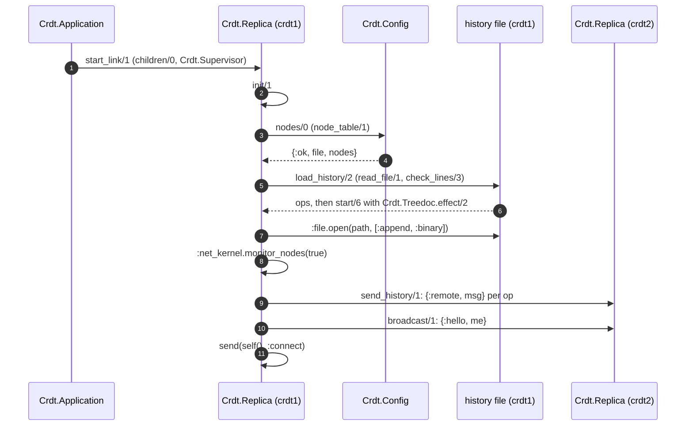
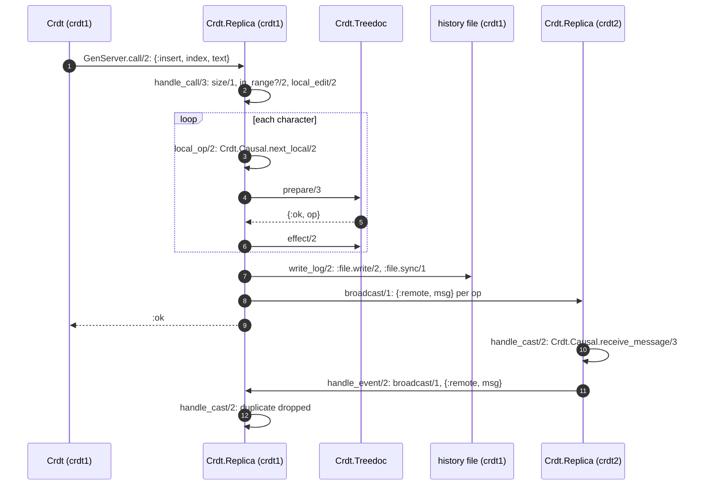
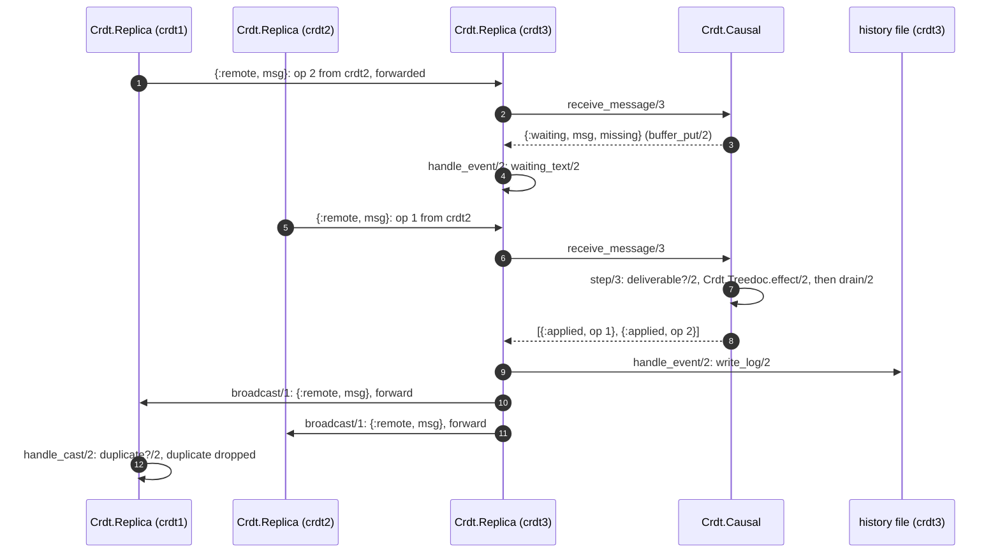
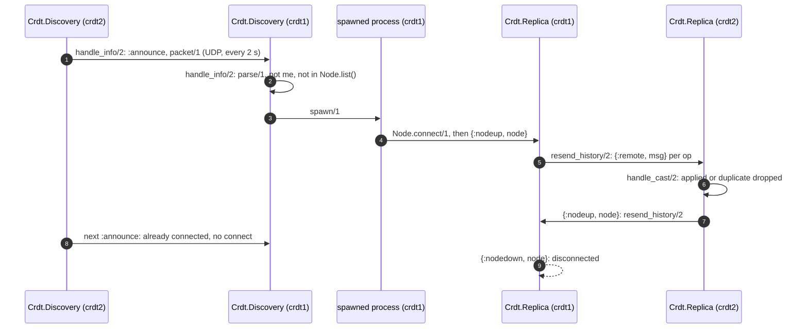

# Code map

A guide to read the code. The code is in `lib/`: eight modules, about
760 lines. Read [DESIGN.md](DESIGN.md) next to it; each step below
names its section. The words used here (op, PosID, tombstone, vector
clock) are in the [glossary](MANUAL-TESTS.md#glossary).

- [1. Study path](#1-study-path)
- [2. Module map](#2-module-map)
- [3. Sequence diagrams](#3-sequence-diagrams)
- [4. Explore it live](#4-explore-it-live)

## 1. Study path

Pure modules first: they have no processes, network or files. Then the
API, and last the process that joins everything.

### Step 1: `Crdt.Treedoc`, the CRDT

- Read: `new/0`, `compare/2`, `prepare/3`, `new_pos/4`, `effect/2`,
  `value/1`, `debug_rows/1`.
- With: `DESIGN.md` DES3 (DES3.1 PosID, DES3.3 order, DES3.4 new PosID, DES3.5
  state).
- Afterwards you can answer:
  - Where does a character inserted between two others go in the tree?
  - Why does a deleted character stay in `chars`?
  - Why do two nodes that apply the same ops in different orders end
    with the same text?

### Step 2: `Crdt.Causal`, causal delivery

- Read: `next_local/2`, `duplicate?/2`, `deliverable?/2`,
  `receive_message/3`, `step/3`, `drain/2`, `missing/2`.
- With: `DESIGN.md` DES4.1 and DES4.2.
- Afterwards you can answer:
  - When is a message applied, kept in the buffer or dropped?
  - Why is the clock of a local op kept only if `prepare/3` succeeds?
  - What takes a message out of the buffer?

### Step 3: `Crdt.LogFormat`, the history file format

- Read: `to_json_line/1`, `from_json_line/1`, `to_msg/1`,
  `with_base/2`.
- With: `DESIGN.md` DES5.2.
- Afterwards you can answer:
  - Why are node names strings in the file and atoms in memory?
  - What does `from_json_line/1` return for a line cut in half?

### Step 4: `Crdt.Config` and `Crdt.Discovery`, how nodes meet

- Read: `Crdt.Config.nodes/0`, `parse/1`; `Crdt.Discovery.init/1`,
  `open/2`, `parse/1`, `handle_info/2`.
- With: `DESIGN.md` DES6 and DES6.1.
- Afterwards you can answer:
  - What happens with a Windows line ending and with a `#` line?
  - What does the replica do if `NODES_FILE` names a missing file, and
    what if `NODES_FILE` is not set?
  - Why does only one node per computer listen for announcements?
  - Why does a packet from another program never open a connection?

### Step 5: `Crdt` and `Crdt.Application`, the entry points

- Read: `Crdt.insert/2`, `Crdt.delete/2`, `Crdt.status/0`, `call/1`,
  `print/1`; `Crdt.Application.start/2`, `children/0`.
- With: `DESIGN.md` DES9 and DES6 (a node without `--name`).
- Afterwards you can answer:
  - What does every `Crdt` function return when the replica is not
    running?
  - Why do `status/0`, `history/0` and `debug/0` print in the caller and
    not in the replica?
  - Why does `mix test` work without `--name`?

### Step 6: `Crdt.Replica`, the process

- Read: `init/1`, `start/6`, `load_history/2`, `read_lines/4`,
  `handle_call/3` (insert), `local_edit/2`, `local_op/2`, `write_log/2`,
  `handle_cast/2`, `handle_event/2`, `handle_info/2`, `broadcast/1`.
- With: `DESIGN.md` DES4.4, DES4.5, DES6, DES7 and DES7.1.
- Afterwards you can answer:
  - Why does nothing leave the node before `:file.sync/1`?
  - Why does `Node.connect/1` run in a separate process?
  - Why does the replica resend its whole history on `:nodeup` and on
    `{:hello, node}`?
  - Why does the history file not change when the IP changes?

## 2. Module map

Responsibilities as in `DESIGN.md` DES8. "Calls" names the functions of
this project that each function calls.

### `Crdt.Treedoc` (`lib/crdt/treedoc.ex`)

- Responsibility: the CRDT. Pure.
- Data: the state `%{chars: %{posid => ch}, dead: MapSet}`. A PosID is a
  list of steps `{bit, seq, node}`: bit 0 is left, 1 is right. `dead`
  holds the tombstones.
- `new/0` (public): the empty document. DES3.1, DES3.5.
- `compare/2` (public): order of two PosIDs, `:lt`, `:eq` or `:gt`, by
  in-order traversal. DES3.2, DES3.3.
- `prepare/3` (public): at the origin, turns `{:insert, index, ch}` or
  `{:delete, index}` into an op; does not change the state. Calls
  `visible_positions/1`, `valid_index?/2`, `new_pos/4`. DES3.4, DES3.5.
- `effect/2` (public): applies an op on every node: adds `pos => ch`,
  or adds `pos` to `dead`. DES3.5.
- `value/1` (public): the visible text. Calls `visible_positions/1`.
  DES3.5.
- `debug_rows/1` (public): every character in order as
  `{ch, pos, deleted?}`. Calls `sorted_positions/1`. DES3.5, DES9.
- `new_pos/4` (private): left child of the right neighbour, or right
  child of the left one. DES3.4.
- `sorted_positions/1` (private): every PosID, sorted with `compare/2`.
  DES3.3.
- `visible_positions/1` (private): the sorted PosIDs without the
  tombstones. Calls `sorted_positions/1`. DES3.5.

### `Crdt.Causal` (`lib/crdt/causal.ex`)

- Responsibility: the rules of causal delivery. Pure.
- Data: none of its own. It works on `%{vc: _, buffer: _, doc: _}`,
  given by the replica. `vc` is `%{node => count}`; a missing key counts
  as 0. `buffer` is a list of waiting messages.
- `next_local/2` (public): the candidate `{seq, vc}` for a local op.
  DES4.1.
- `duplicate?/2` (public): true if the message was already applied.
  DES4.2.
- `deliverable?/2` (public): true if the message can be applied now.
  DES4.2.
- `receive_message/3` (public): apply, wait or drop, then empty what it
  can of the buffer; returns `{state, events}`. Calls `step/3`,
  `drain/2`. DES4.2.
- `missing/2` (public): what a waiting message still needs, as
  `%{node => seq}`. DES4.2, DES9.
- `step/3` (private): one message: `{:duplicate, msg}`,
  `{:applied, msg}` (calls the `apply_fun`, `Crdt.Treedoc.effect/2`) or
  `{:waiting, msg, missing}`. Calls `duplicate?/2`, `deliverable?/2`,
  `buffer_put/2`, `missing/2`. DES4.2.
- `drain/2` (private): takes out of the buffer the first message that is
  ready or duplicate, and repeats. Calls `step/3`. DES4.2.
- `buffer_put/2` (private): adds a message to the buffer, at most one
  copy per op. DES4.2.

### `Crdt.LogFormat` (`lib/crdt/log_format.ex`)

- Responsibility: messages to JSON lines and back. Pure.
- Data: none.
- `to_json_line/1` (public): one JSON line ending in `"\n"`, keys in a
  fixed order. Uses the `JSON` module. DES5.2.
- `from_json_line/1` (public): `{:ok, msg}` or `{:error, reason}`; never
  raises. Calls `to_msg/1`. DES5.2, DES4.5.
- `to_msg/1` (private): checks `op` and `ch`. Calls `with_base/2`.
  DES5.2.
- `with_base/2` (private): checks `from`, `vc` and `pos`, and turns
  names back into atoms and steps into tuples. DES5.2.

### `Crdt.Config` (`lib/crdt/config.ex`)

- Responsibility: reads the optional node table. Reads a file.
- Data: none. The file name comes from `NODES_FILE`; without it the
  table is empty.
- `nodes/0` (public): `{:ok, file, nodes}`, `{:ok, "none", []}` without
  `NODES_FILE`, or `{:error, file, reason}`. Calls `read/1`. DES6.
- `read/1` (private): reads the file. Calls `parse/1`. DES6.
- `parse/1` (private): one name per line, trimmed; skips blank and `#`
  lines. DES6.

### `Crdt` (`lib/crdt.ex`)

- Responsibility: the API to use from IEx. No state.
- Data: none.
- `insert/2` (public): `{:insert, index, text}` to the replica. Calls
  `call/1`. DES9, DES7.
- `delete/1`, `delete/2` (public): `{:delete, index, count}`, `count`
  1 by default. Calls `call/1`. DES9.
- `text/0` (public): the visible text. Calls `call/1`. DES9.
- `status/0`, `history/0`, `history/1`, `debug/0` (public): ask for
  lines and print them here. Call `call/1`, `print/1`. DES9.
- `call/1` (private): `GenServer.call/2` to `Crdt.Replica`, or
  `{:error, :no_replica}` if it is not running. DES9.
- `print/1` (private): prints a list of lines, or returns the error.
  DES9.

### `Crdt.Application` (`lib/crdt/application.ex`)

- Responsibility: starts the supervisor and checks that the node has a
  name.
- Data: none.
- `start/2` (public): starts `Crdt.Supervisor`. Calls `children/0`. DES6.
- `children/0` (public): `[Crdt.Replica, Crdt.Discovery]` on a named
  node, `[Crdt.Replica]` with `DISCOVERY=off`; otherwise calls
  `no_name/0`. DES6, DES6.1.
- `no_name/0` (private): prints the start commands and returns `[]`.
  DES6, DES11.

### `Crdt.Discovery` (`lib/crdt/discovery.ex`)

- Responsibility: announces the node on the local network and connects
  to the nodes it hears. UDP multicast.
- Data, the fields of the state:
  - `me`: the name it announces.
  - `port`: the discovery port, 45892.
  - `socket`: the UDP socket.
  - `mode`: `"listening on 45892"` or `"announce only"`.
  - `heard`: the node names heard, for `Crdt.status()`.
- Messages it handles: `:announce` (every 2 seconds), UDP packets
  `{:udp, socket, ip, port, data}`, and the call `:info`.
- `start_link/1` (public): starts the GenServer with the options `:me`,
  `:ip` and `:port`. DES8.
- `info/0` (public): `{mode, heard}`, for `Crdt.status()`. DES9.
- `packet/1` (public): the text `crdt-treedoc-1 <node name>`. DES6.1.
- `parse/1` (public): `{:ok, node}` if the packet has the tag, otherwise
  `:ignore`. DES6.1.
- `init/1` (public): opens the socket and sends the first `:announce`;
  `:ignore` with a message if no socket can be opened. Calls
  `interface/1`, `open/2`. DES6.1, DES6.
- `interface/1` (private): the IPv4 of the node name, or `{0, 0, 0, 0}`.
  DES6.1.
- `open/2` (private): listens on the port, or, if it is busy, opens a
  socket on a free port that only announces. Calls `listen/3`. DES6.1.
- `listen/3` (private): the socket on the port, joined to the group.
  DES6.1.
- `handle_call/3` (public): `:info`. DES9.
- `handle_info/2` (public): `:announce` sends `packet/1` and repeats in
  2 seconds; a packet with the tag, not its own and not of a connected
  node, spawns one `Node.connect/1`. Calls `packet/1`, `parse/1`.
  DES6.1, DES7.1.

### `Crdt.Replica` (`lib/crdt/replica.ex`)

- Responsibility: the GenServer that owns the node's state; joins the
  CRDT, causal delivery, network, file and console.
- Data, the fields of the state:
  - `me`: this node's name.
  - `nodes_file`: where the table came from, for `Crdt.status()`.
  - `nodes`: the node table, a list of atoms.
  - `path`: the history file, for example `data/crdt1.jsonl`.
  - `log`: the history file, open for appending.
  - `doc`: the `Crdt.Treedoc` state.
  - `vc`: the vector clock.
  - `buffer`: messages waiting for an earlier op.
  - `history`: every applied op, in the order it was applied.
- Messages it handles:
  - Calls from `Crdt`: `{:insert, index, text}`,
    `{:delete, index, count}`, `:text`, `:status`, `{:history, which}`,
    `:debug`.
  - Casts from other nodes: `{:remote, msg}` and `{:hello, node}`.
  - Others: `{:nodeup, node}`, `{:nodedown, node}`, `:connect`.
- `start_link/1` (public): starts the GenServer with the options `:me`,
  `:nodes`, `:data_dir` and `:name`. DES8.
- `init/1` (public): the start order; `:ignore` with a message if the
  table or the history is wrong. Calls `node_table/1`,
  `history_path/2`, `load_history/2`, `start/6`. DES4.4, DES6.
- `node_table/1` (private): the `:nodes` option or
  `Crdt.Config.nodes/0`. DES6.
- `history_path/2` (private): `<data_dir>/<name>.jsonl`, with the part
  of the node name before `@`. DES4.5.
- `start/6` (private): rebuilds `doc`, `vc` and `history` from the file
  with `Crdt.Treedoc.effect/2`, turns on `:net_kernel.monitor_nodes/1`,
  sends the history and `{:hello, me}`, starts the `:connect` timer.
  Calls `send_history/1`, `broadcast/1`. DES4.4, DES4.5.
- `load_history/2` (private): reads and checks the file, then opens it
  for appending. Calls `read_file/1`, `check_lines/3`. DES4.5.
- `read_file/1` (private): a missing file is an empty history. DES4.5.
- `check_lines/3` (private): cuts an incomplete last line. Calls
  `read_lines/4`, `truncate/2`. DES4.5.
- `read_lines/4` (private): `{:ok, ops}`, `{:incomplete, ops, bytes}` or
  `{:corrupted, line}`. Calls `Crdt.LogFormat.from_json_line/1`. DES4.5.
- `truncate/2` (private): cuts the file at the last good byte and syncs.
  DES4.5.
- `write_log/2` (private): writes lines and does one `:file.sync/1`.
  Calls `Crdt.LogFormat.to_json_line/1`. DES4.5.
- `handle_call/3` (public): local edits and queries. Calls
  `local_edit/2`, `size/1`, `status_lines/1`, `describe/2`,
  `Crdt.Treedoc.value/1`, `Crdt.Treedoc.debug_rows/1`. DES4.5, DES7, DES9.
- `handle_cast/2` (public): `{:remote, msg}` goes to
  `Crdt.Causal.receive_message/3` and then `handle_event/2`;
  `{:hello, node}` calls `resend_history/2`. DES4.2, DES4.4.
- `handle_info/2` (public): `{:nodeup, node}` calls `resend_history/2`;
  `{:nodedown, node}` prints `disconnected`; `:connect` spawns one
  `Node.connect/1` per missing node and repeats every 2 seconds. DES4.4,
  DES6, DES7.1.
- `local_edit/2` (private): every character of one call, then one write
  and the broadcast. Calls `local_op/2`, `write_log/2`, `broadcast/1`.
  DES4.5, DES7.
- `local_op/2` (private): one character. Calls
  `Crdt.Causal.next_local/2`, `Crdt.Treedoc.prepare/3`,
  `Crdt.Treedoc.effect/2`. DES4.1.
- `handle_event/2` (private): `applied` writes, prints and forwards;
  `waiting` and `duplicate` only print. Calls `write_log/2`,
  `broadcast/1`, `describe/2`, `waiting_text/2`. DES4.2, DES4.3, DES4.5.
- `resend_history/2` (private): prints the notice and calls
  `send_history/1`. DES4.4.
- `send_history/1` (private): `{:remote, msg}` for every op of the
  history, in order. Calls `broadcast/1`. DES4.4.
- `broadcast/1` (private): `GenServer.cast/2` to every connected node.
  DES6.
- `status_lines/1` (private): the lines of `Crdt.status()`. Calls
  `Crdt.Discovery.info/0`, `found/3`, `waiting_text/2`. DES9.
- `found/3` (private): how a connected node was found: `table`,
  `announced` or `other`. DES9.
- `waiting_text/2` (private): the `waiting` line. Calls
  `Crdt.Causal.missing/2`. DES9.
- `describe/2` (private): `op N from node: ins "a"`, also for a delete.
  DES9.
- `size/1` (private): the number of visible characters. Calls
  `Crdt.Treedoc.debug_rows/1`. DES7.

## 3. Sequence diagrams

### Replica start



The table is read before the history, so a bad table never opens the
file. Loading the file rebuilds the document, the clock and the history
without `Crdt.Causal`. The node then sends its history once, to the
nodes already connected, and asks them with `{:hello, me}` to send
theirs. If the table or the file is wrong, `init/1` prints what to fix
and returns `:ignore` (`DESIGN.md` DES4.4, DES6).

### Local edit from crdt1 to crdt2



The index is checked first; a bad one changes nothing. Every character
is prepared and applied on the state left by the previous one, inside
one call, so no remote op lands in the middle of the text. All the
lines are written with one `:file.sync/1` before anything is sent. crdt2
applies each op and forwards it once; the copy that comes back to crdt1
is dropped (`DESIGN.md` DES4.5, DES7, DES4.3).

### Remote message with wait and forward



Op 2 from crdt2 reaches crdt3 through crdt1 before op 1, so it waits in
the buffer. When op 1 arrives, `step/3` applies it and `drain/2` applies
op 2 from the buffer. Each applied op is written to disk, printed and
forwarded once, unchanged. The forwarded copies are duplicates for the
others and are dropped, so forwarding ends (`DESIGN.md` DES4.2, DES4.3).

### Node connection



crdt1 listens on the discovery port; crdt2, on the same computer, only
announces. `Node.connect/1` runs in a short-lived process, so a slow
connect never blocks anything. Both replicas get `:nodeup` and resend
their history to every connected node. The node table works the same
way, from `Crdt.Replica`'s `:connect` timer. If Erlang connects the
nodes before a replica exists, the `{:hello, node}` of its start asks
for the history again (`DESIGN.md` DES4.4, DES6, DES6.1, DES7.1).

## 4. Explore it live

Start three nodes as in [MANUAL-TESTS.md](MANUAL-TESTS.md), "Before you
start". The outputs below are from a real run, from an empty `data`
folder. The order of the keys inside a map may differ on your
computer.

### The documentation of a module and a function

In **crdt1**:

```elixir
h Crdt
```

```
                                      Crdt

Collaborative text editor with no central server (REQ1), on Treedoc; small
modules (CON5, DES8). IEx API (CON6, DES9). Codes such as REQ7 or PAP3.1:
README.md, "How to read this project".
```

```elixir
h Crdt.insert
```

```
                            def insert(index, text)

Inserts each character of `text` starting at `index`, in one call (REQ3,
REQ20).
```

### The state of the replica

In **crdt1**: `Crdt.insert(0, "ab")`. Then in **crdt2**:

```elixir
:sys.get_state(Crdt.Replica)
```

```
%{
  nodes: [],
  log: #PID<20780.146.0>,
  path: "data/crdt2.jsonl",
  buffer: [],
  doc: %{
    dead: MapSet.new([]),
    chars: %{
      [{1, 1, :"crdt1@127.0.0.1"}] => "a",
      [{1, 1, :"crdt1@127.0.0.1"}, {1, 2, :"crdt1@127.0.0.1"}] => "b"
    }
  },
  history: [
    %{
      op: :ins,
      from: :"crdt1@127.0.0.1",
      vc: %{"crdt1@127.0.0.1": 1},
      pos: [{1, 1, :"crdt1@127.0.0.1"}],
      ch: "a"
    },
    %{
      op: :ins,
      from: :"crdt1@127.0.0.1",
      vc: %{"crdt1@127.0.0.1": 2},
      pos: [{1, 1, :"crdt1@127.0.0.1"}, {1, 2, :"crdt1@127.0.0.1"}],
      ch: "b"
    }
  ],
  me: :"crdt2@127.0.0.1",
  vc: %{...},
  ...
}
```

- These are the fields of section 2. IEx cuts long values with `...`.
  `nodes` is empty: there is no node table, discovery found the nodes.
- `"b"` is the right child of `"a"`: it was typed after it.
- `log` is the open history file (an Erlang process).

### Watch the messages arrive

In **crdt2**, turn the trace on:

```elixir
:sys.trace(Crdt.Replica, true)
```

It returns `:ok`. In **crdt1**: `Crdt.insert(2, "c")`. crdt2's console
shows each message and the new state after it (cut here):

```
*DBG* 'Elixir.Crdt.Replica' got cast {remote,
                                      #{op => ins,
                                        pos =>
                                         [{1,1,'crdt1@127.0.0.1'},
                                          {1,2,'crdt1@127.0.0.1'},
                                          {1,3,'crdt1@127.0.0.1'}],
                                        from => 'crdt1@127.0.0.1',
                                        vc => #{'crdt1@127.0.0.1' => 3},
                                        ch => <<"c">>}}
[crdt2@127.0.0.1] applied op 3 from crdt1@127.0.0.1: ins "c"
*DBG* 'Elixir.Crdt.Replica' new state #{nodes => [],log => <0.146.0>,
...
*DBG* 'Elixir.Crdt.Replica' got cast {remote,
...
[crdt2@127.0.0.1] duplicate dropped: op 3 from crdt1@127.0.0.1
...
*DBG* 'Elixir.Crdt.Replica' got connect
```

- The first cast comes from crdt1; the second is crdt3's forward.
- The trace is in Erlang syntax: `<<"c">>` is the string `"c"`.
- `got connect` repeats every 2 seconds. Turn the trace off soon, in
  **crdt2**:

```elixir
:sys.trace(Crdt.Replica, false)
```

It returns `:ok`.

### Build a document by hand

`Crdt.Treedoc` is pure: it works in any IEx, with any atom as the node
name. In **crdt1**, one command at a time:

```elixir
doc = Crdt.Treedoc.new()
```

```
%{dead: MapSet.new([]), chars: %{}}
```

```elixir
{:ok, op_a} = Crdt.Treedoc.prepare(doc, {:insert, 0, "a"}, {1, :n1})
```

```
{:ok, %{op: :ins, pos: [{1, 1, :n1}], ch: "a"}}
```

```elixir
doc = Crdt.Treedoc.effect(doc, op_a)
```

```
%{dead: MapSet.new([]), chars: %{[{1, 1, :n1}] => "a"}}
```

```elixir
{:ok, op_c} = Crdt.Treedoc.prepare(doc, {:insert, 1, "c"}, {2, :n1})
```

```
{:ok, %{op: :ins, pos: [{1, 1, :n1}, {1, 2, :n1}], ch: "c"}}
```

```elixir
doc = Crdt.Treedoc.effect(doc, op_c)
```

```elixir
{:ok, op_b} = Crdt.Treedoc.prepare(doc, {:insert, 1, "b"}, {3, :n1})
```

```
{:ok, %{op: :ins, pos: [{1, 1, :n1}, {1, 2, :n1}, {0, 3, :n1}], ch: "b"}}
```

```elixir
doc = Crdt.Treedoc.effect(doc, op_b)
```

```elixir
Crdt.Treedoc.value(doc)
```

```
"abc"
```

```elixir
Crdt.Treedoc.debug_rows(doc)
```

```
[
  {"a", [{1, 1, :n1}], false},
  {"b", [{1, 1, :n1}, {1, 2, :n1}, {0, 3, :n1}], false},
  {"c", [{1, 1, :n1}, {1, 2, :n1}], false}
]
```

- `"c"` is the right child of `"a"` (step `{1, 2, :n1}`).
- `"b"` goes between them: the left child of `"c"` (step `{0, 3, :n1}`).
- `prepare/3` changes nothing; only `effect/2` does.

Now delete the first character:

```elixir
{:ok, op_del} = Crdt.Treedoc.prepare(doc, {:delete, 0}, nil)
```

```
{:ok, %{op: :del, pos: [{1, 1, :n1}]}}
```

```elixir
doc = Crdt.Treedoc.effect(doc, op_del)
```

```elixir
Crdt.Treedoc.value(doc)
```

```
"bc"
```

```elixir
Crdt.Treedoc.debug_rows(doc)
```

```
[
  {"a", [{1, 1, :n1}], true},
  {"b", [{1, 1, :n1}, {1, 2, :n1}, {0, 3, :n1}], false},
  {"c", [{1, 1, :n1}, {1, 2, :n1}], false}
]
```

- `"a"` is a tombstone: hidden, kept with its character. `"b"` and
  `"c"` keep their PosIDs because PosIDs never change (PAP2.1).

Two more:

```elixir
Crdt.Treedoc.prepare(doc, {:insert, 9, "z"}, {4, :n1})
```

```
{:error, :invalid_index}
```

```elixir
Crdt.Treedoc.compare([{1, 1, :n1}, {0, 3, :n1}], [{1, 1, :n1}])
```

```
:lt
```

- The second one: `"b"` comes before `"c"`, because it is in the left
  subtree of `"c"`.
